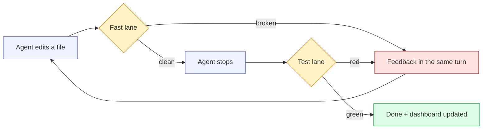

<div align="center">

# 🛡️ Revizor

### The agent edits code. Revizor makes sure it's actually right.

A self-verifying coding loop for **ZCode** — checks after every edit, tests before every "done",
and a dashboard that tells you the truth.

<br>

[](https://github.com/Artemik0922/revizor/actions/workflows/ci.yml)
[](CHANGELOG.md)
[](LICENSE)
[](https://nodejs.org)
[](revizor/package.json)
[](revizor/test)
[](https://z.ai)
[](#-configuration)
[](#-contributing)

**[English](README.md)** · [Русский](README.ru.md)

</div>

---

## 💡 The problem

Agentic coding has one systemic flaw: **the model believes it succeeded.**

It writes a file, says "done", and nobody checked. The build is broken, a test is red, a
`console.log` leaked into production — and you find out later, alone.

Revizor closes that loop with hooks instead of hope. Every edit is verified within milliseconds,
every completion is gated by your real test suite, and every failure lands back in the agent's
context — where it can still act on it.

<div align="center">



</div>

---

## ✨ Features

<table>
<tr>
<td width="50%" valign="top">

### ⚡ Fast lane
Checks the changed file in milliseconds — `JSON.parse`, `node --check`,
`tsc --noEmit`, and **inline `<script>` blocks of `.html`** files.
Vanilla projects get real coverage too.

### 🧪 Test lane
Runs your tests **only when files actually changed**.
Red → the agent keeps working. Green → a light confirmation,
so "passed" never looks like "skipped".

### 🤖 Auto mode
`/revizor-auto on` injects a protocol into the session:
the agent runs tests, fixes feedback and ships on its own.
Survives context compaction.

</td>
<td width="50%" valign="top">

### 🚧 Edit guard
Rejects edits inside `node_modules`, `dist`, `build`, `.git`, `.zcode`.
Generated code stays generated.

### 🧠 Error brain
From the second failure of the same command, nudges the agent
to change approach instead of hammering the same broken command.

### 📊 Live dashboard
A single static HTML page: verdict, lane statuses,
SVG trend sparklines, recent failures, config.
No server. No ports. Works over `file://`.

</td>
</tr>
</table>

### 🎯 Commands

| Command | Emoji | What it does |
|---|:---:|---|
| `/audit` | 🔍 | P0–P3 diagnostics with `file:line`, i18n key parity, dead code, duplicates. **No edits.** |
| `/polish` | 💎 | Refactor to ideal: green baseline → plan → batches with tests after each → before/after report |
| `/ship` | 🚀 | Release gate: build, debug leftovers, **secret scan** → READY / DO-NOT-SHIP |
| `/trend` | 📈 | Metric dynamics: is quality improving or degrading? |
| `/dashboard` | 📊 | Generate and open the HTML overview |
| `/doctor` | 🩺 | Outdated/vulnerable deps, secrets in code, build size vs budget |
| `/checks` | 📋 | Lane configuration and recent runs |
| `/revizor-fix` | 🔧 | Minimal fix of the last failed check |
| `/revizor-auto` | 🤖 | `on` / `off` / `status` |

---

## 🚀 Install

```text
1.  ZCode  →  🧩 Plugin Marketplace
2.  ➕ Add  →  Add Plugin Marketplace
3.  Paste:  https://github.com/Artemik0922/revizor
4.  👤 Personal  →  Revizor  →  ⬇️ Install
```

> Manage it later in **⚙️ Settings → Plugins**.
> Prefer local sources? Use the clone path instead of the URL.

---

## ⚡ Quick start

Create `revizor.json` in your project root. **Everything is optional** — built-in checks work without it.

```json
{
  "test":    [{ "run": "npm test",              "timeoutMs": 180000 }],
  "fast":    [{ "match": "\\.ts$", "run": "npx tsc --noEmit", "timeoutMs": 30000 }],
  "ship":    [{ "run": "npm run build",         "timeoutMs": 300000 }],
  "quality": [{ "run": "npx eslint .",          "timeoutMs": 120000 }]
}
```

Then just work:

- 🐛 Edit a file with a syntax error → **feedback arrives immediately**, in the same turn.
- 🔴 Finish a task with red tests → **the Stop hook sends the failures back**.
- 🤖 Want it hands-off? → `/revizor-auto on`.

---

## ⚙️ Configuration

| Key | Default | Meaning |
|---|---|---|
| `lang` | `"auto"` | `auto` detects a Russian locale · or force `"en"` / `"ru"` |
| `auto` | `false` | Auto mode (mirrors the `.revizor-auto` file) |
| `fastDebounceMs` | `8000` | Minimum gap between fast checks |
| `testDebounceMs` | `15000` | Minimum gap between test runs |
| `maxOutputChars` | `4000` | Feedback truncation limit |
| `sizeBudgetKb` | — | Build budget for `/doctor` |
| `guardAllow` | `[]` | Folders the guard may edit, e.g. `["dist"]` |
| `off` | all `false` | Kill switches: `fast`, `test`, `quality`, `guard`, `brain` |
| `fast` `test` `quality` `ship` | — | Check lanes ↓ |

**Lane semantics**

| Written as | Means |
|---|---|
| *missing* | ✅ Built-in behavior |
| `[]` | ⛔ Lane disabled |
| `"npm test"` | ✍️ Shorthand for `{ "run": "npm test" }` |
| `{ run, name, match, cwd, timeoutMs }` | 🎛️ Full check — `match` is a regex on the project-relative path; a timeout counts as a failure |

> 🆘 **Emergency off:** create `.revizor-off` in the project root, or set `REVIZOR_OFF=1`.

---

## 🧩 How it works

<details>
<summary><b>🔌 Hooks — five events, five small Node scripts</b></summary>

<br>

| Event | Script | Purpose |
|---|---|---|
| `SessionStart` | `auto-boot.js` | Stamps the plugin into project state · injects the auto-mode protocol |
| `PreToolUse` | `guard.js` | Blocks edits inside generated folders |
| `PostToolUse` | `fast-check.js` | Checks the file that was just written |
| `PostToolUseFailure` | `failure-note.js` | Counts repeated command failures, nudges a new approach |
| `Stop` | `stop-check.js` | Runs the test lane · regenerates the dashboard |

Each script receives the tool payload on **stdin** and answers the way ZCode expects:

| Situation | Response |
|---|---|
| ✅ Silent pass | exit `0`, no output |
| ❌ Tool-event failure | message on `stderr` + exit `2` |
| ❌ Stop-hook failure | `{"decision":"block","reason":"…"}` |
| ✅ Stop-hook success | `{"continue":true,"systemMessage":"…"}` |
| 💉 Session context | `{"hookSpecificOutput":{"additionalContext":"…"}}` |

</details>

<details>
<summary><b>🗃️ State — <code>.zcode/revizor-state.json</code></b></summary>

<br>

| Field | Holds |
|---|---|
| `lastFast` / `lastTest` | Time, result, failures of the latest runs |
| `changedSinceTest` | Files waiting for the next test run |
| `lastFailures` | The most recent failure — input for `/revizor-fix` |
| `history` | Metric snapshots from `/audit` and `/ship` — fuel for `/trend` |
| `lastAudit` | P0–P3 totals from the latest audit |
| `failures` | Command failure counters for the error brain |
| `pluginRoot` | Plugin stamp — how `/dashboard` finds the generator |

> 📌 Add `.zcode/` to your `.gitignore`.

</details>

<details>
<summary><b>📁 Repository layout</b></summary>

<br>

```text
revizor/
├── marketplace.json          ← the repo root is an installable marketplace
├── README.md · README.ru.md  ← you are here
├── CHANGELOG.md · LICENSE
├── .github/workflows/ci.yml  ← Ubuntu + Windows × Node 20/24
└── revizor/                  ← the plugin itself
    ├── .zcode-plugin/plugin.json
    ├── hooks/hooks.json
    ├── scripts/              ← 8 zero-dependency Node scripts
    ├── commands/             ← 9 slash commands
    ├── skills/revizor/       ← the agent-facing skill
    └── test/                 ← 30 tests on node:test
```

</details>

---

## 🔒 Security note

Revizor executes the commands **you** put into `revizor.json`, through your shell.
Treat that file as trusted code — exactly like `scripts` in `package.json`.

- 🚫 Nothing is downloaded or executed on its own.
- 🛡️ `guard` keeps the agent out of generated folders.
- 🔍 `/ship` and `/audit` scan for leaked secrets and never print their full values.

---

## 🛠️ Development

```bash
cd revizor
npm test        # 🧪 30 tests · node:test · zero dependencies
```

```bash
node --check scripts/*.js        # syntax gate
gh run watch                     # CI status
```

---

## 🤝 Contributing

Issues and PRs are welcome. The bar is simple:

- 🟢 `npm test` stays green
- 🧪 new behavior comes with a test
- 📝 docs match reality

---

## 📜 License

<div align="center">

**[MIT](LICENSE)** © 2026 Artemik0922

<br>

**Built for agents that would rather be checked than trusted.**

⭐ Star the repo if your agent has ever said "done" while everything was on fire.

</div>
