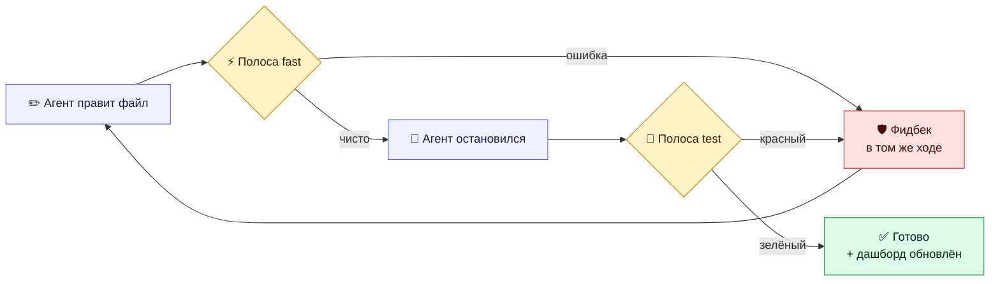

<div align="center">

# 🛡️ Ревизор

### Агент правит код. Ревизор убеждается, что это правда работает.

Самопроверяющийся цикл кодинга для **ZCode** — проверка после каждой правки, тесты до каждого «готово»,
и дашборд, который говорит правду.

<br>

[](https://github.com/Artemik0922/revizor/actions/workflows/ci.yml)
[](CHANGELOG.md)
[](LICENSE)
[](https://nodejs.org)
[](revizor/package.json)
[](revizor/test)
[](https://z.ai)
[](#-конфигурация)
[](#-участие)

**[English](README.md)** · [Русский](README.ru.md)

</div>

---

## 💡 Проблема

У агентного кодинга один системный изъян: **модель считает, что у неё получилось.**

Она пишет файл, говорит «готово» — и никто не проверил. Сборка сломана, тест красный,
`console.log` утёк в прод — и ты узнаёшь об этом позже. Один.

«Ревизор» закрывает этот цикл хуками вместо надежды. Каждая правка проверяется за миллисекунды,
каждое завершение задачи гейтится настоящими тестами, а каждый провал возвращается в контекст
агента — туда, где он ещё может что-то исправить.

<div align="center">



</div>

---

## ✨ Возможности

<table>
<tr>
<td width="50%" valign="top">

### ⚡ Полоса fast
Проверяет изменённый файл за миллисекунды — `JSON.parse`, `node --check`,
`tsc --noEmit` и **инлайн-блоки `<script>` в `.html`**.
Vanilla-проекты тоже получают настоящую защиту.

### 🧪 Полоса test
Гоняет тесты **только когда файлы реально менялись**.
Красный → агент продолжает работу. Зелёный → лёгкое подтверждение,
чтобы «прошло» никогда не выглядело как «не запускалось».

### 🤖 Авто-режим
`/revizor-auto on` вливает протокол в сессию: агент сам гоняет тесты,
чинит фидбек и делает ship. Переживает сжатие контекста.

</td>
<td width="50%" valign="top">

### 🚧 Guard
Блокирует правки в `node_modules`, `dist`, `build`, `.git`, `.zcode`.
Сгенерированный код остаётся сгенерированным.

### 🧠 Мозг ошибок
Со второго падения одной команды подсказывает агенту сменить подход,
а не долбить ту же сломанную команду.

### 📊 Живой дашборд
Один статический HTML-файл: вердикт, статусы полос, SVG-тренды,
провалы, конфиг. Без сервера. Без портов. Открывается по `file://`.

</td>
</tr>
</table>

### 🎯 Команды

| Команда | Эмодзи | Что делает |
|---|:---:|---|
| `/audit` | 🔍 | Диагностика P0–P3 с `file:line`, паритет i18n, мёртвый код, дубли. **Без правок.** |
| `/polish` | 💎 | Доведение до идеала: зелёная база → план → батчи с тестами после каждого → отчёт «было/стало» |
| `/ship` | 🚀 | Release-gate: сборка, остатки дебага, **скан секретов** → READY / DO-NOT-SHIP |
| `/trend` | 📈 | Динамика метрик: качество растёт или падает? |
| `/dashboard` | 📊 | Сгенерировать и открыть HTML-витрину |
| `/doctor` | 🩺 | Устаревшие/уязвимые зависимости, секреты, размер сборки против бюджета |
| `/checks` | 📋 | Конфигурация полос и последние прогоны |
| `/revizor-fix` | 🔧 | Минимальный фикс последней проваленной проверки |
| `/revizor-auto` | 🤖 | `on` / `off` / `status` |

---

## 🚀 Установка

```text
1.  ZCode  →  🧩 Plugin Marketplace
2.  ➕ Add  →  Add Plugin Marketplace
3.  Вставь:  https://github.com/Artemik0922/revizor
4.  👤 Personal  →  Revizor  →  ⬇️ Install
```

> Дальше управление — в **⚙️ Settings → Plugins**.
> Нужен локальный источник? Вставь путь к клону вместо URL.

---

## ⚡ Быстрый старт

Создай `revizor.json` в корне проекта. **Всё опционально** — встроенные проверки работают и без него.

```json
{
  "test":    [{ "run": "npm test",              "timeoutMs": 180000 }],
  "fast":    [{ "match": "\\.ts$", "run": "npx tsc --noEmit", "timeoutMs": 30000 }],
  "ship":    [{ "run": "npm run build",         "timeoutMs": 300000 }],
  "quality": [{ "run": "npx eslint .",          "timeoutMs": 120000 }]
}
```

Дальше просто работай:

- 🐛 Правишь файл с синтаксической ошибкой → **фидбек приходит сразу**, в том же ходе.
- 🔴 Завершаешь задачу с красными тестами → **Stop-хук возвращает провалы агенту**.
- 🤖 Хочешь без ручного управления? → `/revizor-auto on`.

---

## ⚙️ Конфигурация

| Ключ | По умолчанию | Смысл |
|---|---|---|
| `lang` | `"auto"` | `auto` определяет русскую локаль · или принудительно `"en"` / `"ru"` |
| `auto` | `false` | Авто-режим (дублирует файл `.revizor-auto`) |
| `fastDebounceMs` | `8000` | Минимальный интервал между fast-проверками |
| `testDebounceMs` | `15000` | Минимальный интервал между прогонами тестов |
| `maxOutputChars` | `4000` | Лимит усечения фидбека |
| `sizeBudgetKb` | — | Бюджет сборки для `/doctor` |
| `guardAllow` | `[]` | Папки, которые guard пропускает, напр. `["dist"]` |
| `off` | всё `false` | Рубильники: `fast`, `test`, `quality`, `guard`, `brain` |
| `fast` `test` `quality` `ship` | — | Полосы проверок ↓ |

**Семантика полос**

| Записано как | Значит |
|---|---|
| *отсутствует* | ✅ Встроенное поведение |
| `[]` | ⛔ Полоса выключена |
| `"npm test"` | ✍️ Сокращение для `{ "run": "npm test" }` |
| `{ run, name, match, cwd, timeoutMs }` | 🎛️ Полная проверка — `match` это регулярка по пути от корня; таймаут считается провалом |

> 🆘 **Аварийное отключение:** создай `.revizor-off` в корне проекта или установи `REVIZOR_OFF=1`.

---

## 🧩 Как это устроено

<details>
<summary><b>🔌 Хуки — пять событий, пять маленьких Node-скриптов</b></summary>

<br>

| Событие | Скрипт | Назначение |
|---|---|---|
| `SessionStart` | `auto-boot.js` | Штампует плагин в состояние проекта · вливает протокол авто-режима |
| `PreToolUse` | `guard.js` | Блокирует правки в сгенерированных папках |
| `PostToolUse` | `fast-check.js` | Проверяет только что записанный файл |
| `PostToolUseFailure` | `failure-note.js` | Считает повторные падения команд, подсказывает новый подход |
| `Stop` | `stop-check.js` | Гоняет полосу test · перегенерирует дашборд |

Каждый скрипт получает payload инструмента на **stdin** и отвечает так, как ожидает ZCode:

| Ситуация | Ответ |
|---|---|
| ✅ Тихий успех | exit `0`, пустой вывод |
| ❌ Провал события инструмента | сообщение в `stderr` + exit `2` |
| ❌ Провал Stop-хука | `{"decision":"block","reason":"…"}` |
| ✅ Успех Stop-хука | `{"continue":true,"systemMessage":"…"}` |
| 💉 Контекст сессии | `{"hookSpecificOutput":{"additionalContext":"…"}}` |

</details>

<details>
<summary><b>🗃️ Состояние — <code>.zcode/revizor-state.json</code></b></summary>

<br>

| Поле | Хранит |
|---|---|
| `lastFast` / `lastTest` | Время, результат, провалы последних прогонов |
| `changedSinceTest` | Файлы, ожидающие следующего прогона тестов |
| `lastFailures` | Последний провал — вход для `/revizor-fix` |
| `history` | Снимки метрик из `/audit` и `/ship` — топливо для `/trend` |
| `lastAudit` | Итоги P0–P3 последнего аудита |
| `failures` | Счётчики падений команд для мозга ошибок |
| `pluginRoot` | Штамп плагина — по нему `/dashboard` находит генератор |

> 📌 Добавь `.zcode/` в свой `.gitignore`.

</details>

<details>
<summary><b>📁 Структура репозитория</b></summary>

<br>

```text
revizor/
├── marketplace.json          ← корень репо = устанавливаемый маркетплейс
├── README.md · README.ru.md  ← ты здесь
├── CHANGELOG.md · LICENSE
├── .github/workflows/ci.yml  ← Ubuntu + Windows × Node 20/24
└── revizor/                  ← сам плагин
    ├── .zcode-plugin/plugin.json
    ├── hooks/hooks.json
    ├── scripts/              ← 8 Node-скриптов без зависимостей
    ├── commands/             ← 9 слэш-команд
    ├── skills/revizor/       ← скилл для агента
    └── test/                 ← 30 тестов на node:test
```

</details>

---

## 🔒 Безопасность

«Ревизор» исполняет команды, которые **ты** кладёшь в `revizor.json`, через твой shell.
Относись к этому файлу как к доверенному коду — ровно как к `scripts` в `package.json`.

- 🚫 Ничего не скачивается и не запускается само.
- 🛡️ `guard` не пускает агента в сгенерированные папки.
- 🔍 `/ship` и `/audit` ищут утёкшие секреты и никогда не печатают их значения целиком.

---

## 🛠️ Разработка

```bash
cd revizor
npm test        # 🧪 30 тестов · node:test · без зависимостей
```

```bash
node --check scripts/*.js        # проверка синтаксиса
gh run watch                     # статус CI
```

---

## 🤝 Участие

Issues и PR приветствуются. Планка простая:

- 🟢 `npm test` остаётся зелёным
- 🧪 новое поведение приходит с тестом
- 📝 документация соответствует реальности

---

## 📜 Лицензия

<div align="center">

**[MIT](LICENSE)** © 2026 Artemik0922

<br>

**Сделано для агентов, которых лучше проверить, чем доверять.**

⭐ Поставь звезду, если твой агент хоть раз говорил «готово», пока всё горело.

</div>
